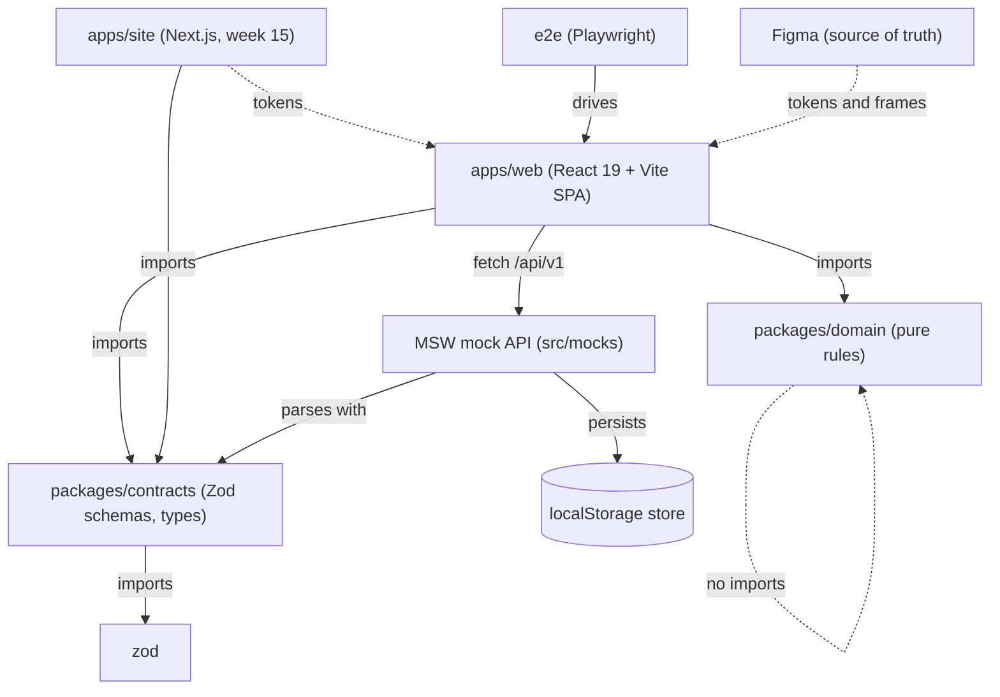

# Initial scaffold: structure and setup

Goal of week 1: this structure exists, `pnpm dev`, `pnpm lint`, `pnpm typecheck`, and `pnpm test` all pass, and CI is green on a pull request. Folders with `.gitkeep` are placeholders for later weeks.

## 1. Structure

```
gam3iya/
├─ AGENTS.md
├─ README.md
├─ package.json                  # root scripts: dev, build, test, lint, typecheck, format
├─ pnpm-workspace.yaml
├─ tsconfig.base.json            # strict: true, noUncheckedIndexedAccess: true
├─ eslint.config.js              # flat config: typescript-eslint, jsx-a11y, no-float-money rule
├─ .prettierrc
├─ .nvmrc
├─ .gitignore
├─ .husky/pre-commit             # lint-staged
├─ .github/
│  ├─ workflows/ci.yml           # install (cache), lint, typecheck, test, build
│  ├─ pull_request_template.md   # story IDs, screenshots LTR/RTL, tests, calibration, explain-back
│  └─ ISSUE_TEMPLATE/
├─ docs/
│  ├─ PRD.md  SRS.md  scaffold.md  questions.md
│  └─ adr/                       # 001-monorepo.md, 002-react-vite.md, 008-stitch-figma.md, ...
├─ plan/
│  ├─ technical-plan.md  milestones.md
│  └─ calibration-log.csv        # work package,type,estimate,actual,ai used,note
├─ design/
│  ├─ DESIGN.md  stitch-prompt.md  figma-links.md  design-decisions.md
├─ apps/
│  └─ web/                       # Vite + React 19 + TypeScript
│     ├─ index.html
│     ├─ vite.config.ts  tsconfig.json  vitest.config.ts
│     ├─ public/                 # mockServiceWorker.js (added in WP 3.3)
│     └─ src/
│        ├─ main.tsx
│        ├─ app/
│        │  ├─ providers.tsx     # QueryClient, i18n, direction, toaster
│        │  ├─ router.tsx        # route table
│        │  └─ routes/           # one module per route (lazy loaded)
│        ├─ features/
│        │  ├─ auth/             # components/ hooks/ api/ schemas/
│        │  ├─ circles/
│        │  ├─ payments/
│        │  ├─ notifications/
│        │  └─ history/
│        ├─ components/ui/       # Button, Field, StatusBadge, Dialog, Tabs, Toast, Skeleton ...
│        ├─ lib/                 # api-client.ts, format.ts, cn.ts, report-error.ts
│        ├─ i18n/                # index.ts, ar.json, en.json
│        ├─ mocks/               # browser.ts, handlers/, store.ts, seed.ts
│        ├─ styles/              # tokens.css, index.css
│        └─ test/                # setup.ts, render-with-providers.tsx
├─ packages/
│  ├─ domain/                    # pure TypeScript, no dependencies
│  │  ├─ package.json
│  │  ├─ src/  money.ts  schedule.ts  payment-status.ts  payout.ts  index.ts
│  │  └─ test/                   # PRD Appendix A examples first
│  └─ contracts/                 # Zod schemas and inferred types
│     ├─ package.json
│     └─ src/  circle.ts  payment.ts  user.ts  api.ts  seed.ts  index.ts
├─ e2e/                          # Playwright (week 13)
│  └─ main-flow.spec.ts
└─ apps/site/                    # Next.js App Router (created in week 15, not before)
```

## 2. Dependency diagram



## 3. Route table (SRS, PRD section 7)

| Route                    | Screen                        | Guard                      |
| ------------------------ | ----------------------------- | -------------------------- |
| `/`                      | S01 Landing                   | public                     |
| `/login`, `/register`    | S02                           | public                     |
| `/join/:token`           | S12 Invite landing            | public (sign-in on accept) |
| `/circles`               | S03 My circles                | auth                       |
| `/circles/new`           | S04 Wizard                    | auth                       |
| `/circles/:id`           | S06 Overview and schedule     | auth, member               |
| `/circles/:id/members`   | S05 Members and invite        | auth, member               |
| `/circles/:id/cycles/:n` | S08 Organizer cycle view      | auth, organizer            |
| `/circles/:id/history`   | S13 History                   | auth, organizer            |
| `/notifications`         | S09                           | auth                       |
| `/settings`              | S10                           | auth                       |
| `/dev/components`        | Gallery (if Storybook is cut) | dev only                   |

## 4. What is already built (mentor starter)

The mentor pre-built this scaffold and verified it: `pnpm install`, `pnpm lint`, `pnpm typecheck`, `pnpm test`, `pnpm build` all pass.

| Area         | State                                                                                                                                                             |
| ------------ | ----------------------------------------------------------------------------------------------------------------------------------------------------------------- |
| Workspace    | pnpm workspaces, `apps/web`, `packages/domain`, `packages/contracts`, internal packages exported as TypeScript source (no build step)                             |
| TypeScript   | 6.x, `strict`, `noUncheckedIndexedAccess`, `verbatimModuleSyntax`                                                                                                 |
| Lint         | ESLint 10 flat config, type-checked, jsx-a11y, react-hooks (v7), custom rules below                                                                               |
| Hooks and CI | Husky + lint-staged on commit; `.github/workflows/ci.yml`; PR template with explain-back                                                                          |
| Claude Code  | `CLAUDE.md` importing `AGENTS.md`, `.claude/settings.json`, tutor-mode settings, `/hint`, `/explain-back`, `/review`                                              |
| Not yet      | Tailwind (WP 1.4), Radix (1.6), Storybook (1.8), React Router (3.1), Zod (3.2), MSW (3.3), TanStack Query (3.4), i18next, Testing Library (4.1), Playwright (4.4) |

Custom lint rules (each verified to fire):

- `packages/domain`: no `parseFloat`, no `new Date()` or `Date.now()`, no imports from React, Zod or other packages
- `apps/web`: no `parseFloat`, no `dangerouslySetInnerHTML`, accessibility rules, hooks rules
- everywhere: no `any`, no non-null assertion, no floating promises

Week 1 for Esraa is therefore "understand, verify and extend", not "type this from scratch" (see `docs/claude-code-kickoff.md`). Add dependencies only in the work package that needs them, with `pnpm --filter <name> add <pkg>` and a one-line reason in the pull request.

## 5. Root scripts (target)

```json
{
  "scripts": {
    "dev": "pnpm --filter web dev",
    "build": "pnpm -r build",
    "test": "pnpm -r test",
    "test:coverage": "pnpm -r test:coverage",
    "test:e2e": "playwright test",
    "lint": "eslint .",
    "typecheck": "pnpm -r typecheck",
    "format": "prettier --write ."
  }
}
```

## 6. Week-1 definition of done

- [ ] Structure above exists (placeholders allowed)
- [ ] `pnpm dev` shows a page; one smoke test per workspace passes
- [ ] Lint and typecheck pass; a deliberate lint error is blocked in CI
- [ ] `main` is protected; first PR merged through the template
- [ ] ADR-001 and ADR-002 drafted; calibration log has the week-1 entries
